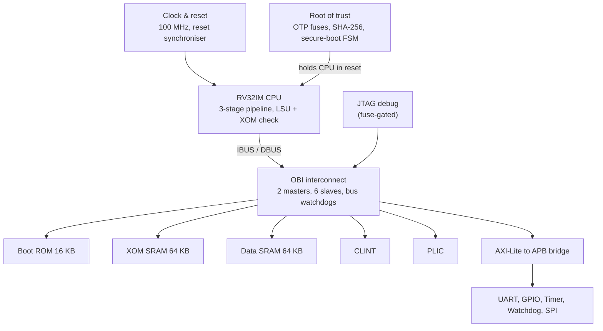
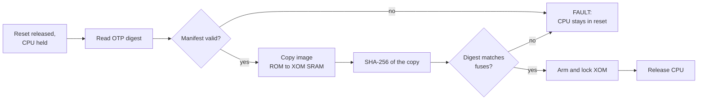

# Secure RISC-V Microcontroller SoC (1-TOPS Semiconductor Program)

A secure **RV32IM microcontroller SoC** built by an 8-member student team in the **1-TOPS Semiconductor Program** of the **VLSI Society of India (VSI)**, selected nationally as one of **37 teams from 550+ proposals**. Target: **65 nm CMOS**, **100 MHz**.

> This repository is a project overview of my contribution. The RTL, testbenches and firmware live in the team's private repository under the program.

## What the chip does

- **3-stage in-order RV32IM pipeline** (fetch, decode, execute/memory/write-back) with separate instruction and data buses.
- **Hardware measured boot:** before the CPU leaves reset, a boot engine copies the firmware from boot ROM into protected SRAM, hashes it with a **SHA-256** engine and compares the digest with a value held in **OTP fuses**. Only on a match does it lock the protection and release the CPU. Any failure leaves the CPU in reset (fail closed).
- **Execute-Only Memory (XOM):** code in the protected region can be fetched and executed, but any data load or store to it is trapped before a bus request is issued, so the firmware cannot be read out by software.
- **Peripherals and interrupts:** UART, GPIO, timer, watchdog and SPI master on an AMBA AXI-Lite to APB path; CLINT (timer and software interrupts) and PLIC (external interrupts); JTAG debug gated by a fuse.

### Secure-boot sequence

## My contributions

- **Unit-level verification** of the CLINT, PLIC, SPI master, AXI-to-APB bridge, APB bus, ALU and data SRAM with self-checking SystemVerilog testbenches: directed, corner-case, protocol-violation, X-propagation and constrained-random tests, with protocol assertions.
- **Machine-timer interrupt and XOM-violation demonstration** on the integrated SoC: timer arming and trap entry/return through the RISC-V machine-mode CSRs, and a forbidden load trapped (cause 24) before any bus request is issued.
- **Firmware stress suite** on the full SoC simulation: 95 checks with 0 failures, 17/17 security probes refused.
- Memory-mapped peripheral interfacing over AXI-Lite to APB, and clock/reset logic.

## Verification approach

Unit testbenches per module, an integration testbench per subsystem, and C firmware (RISC-V GCC) running on the full SoC in simulation; reference models (instruction-set simulator, SHA-256 model), assertions, coverage bins and a single-command regression.

## Tools

Verilog / SystemVerilog, Synopsys VCS and DVE, ModelSim, RISC-V GNU toolchain, Synopsys lint, CDC and synthesis flow scripts.

## Status

RTL complete and verified at unit, subsystem and SoC level. Synthesis and gate-level simulation are ready to run, pending the foundry standard-cell libraries.
